# Database

MySQL/InnoDB in production; SQLite for dev/tests. Money as integer cents; times
UTC `dateTimeTz`. FK constraints + unique indexes enforce integrity.

## ERD

```mermaid
erDiagram
    users ||--o{ external_identities : "maps"
    users ||--o{ role_user : has
    roles ||--o{ role_user : grants
    roles ||--o{ permission_role : has
    permissions ||--o{ permission_role : grants
    users ||--o{ audit_logs : acts

    programmes ||--o{ courses : contains
    courses ||--o{ course_variants : offers
    courses ||--o{ course_modules : contains
    course_modules ||--o{ lessons : contains
    lessons ||--o| course_videos : plays
    courses ||--o{ trainer_assignments : "taught by"
    users ||--o{ trainer_assignments : teaches
    courses ||--o{ materials : attaches
    users ||--o{ enrolments : enrols
    course_variants ||--o{ enrolments : "sold as"
    enrolments ||--o{ lesson_progress : tracks

    users ||--o{ orders : places
    orders ||--o{ order_items : contains
    orders ||--o{ payment_transactions : paid_via
    orders ||--o{ refunds : refunded

    courses ||--o{ groups : has
    groups ||--o{ group_members : contains
    users ||--o{ group_members : member
    courses ||--o{ live_sessions : hosts
    courses ||--o{ announcements : posts

    courses ||--o{ assignments : sets
    assignments ||--o{ assignment_recipients : targets
    assignments ||--o{ assignment_submissions : receives
    assignment_submissions ||--o{ assignment_attachments : has
    assignment_submissions ||--o| assignment_grades : graded
    users ||--o{ assignment_submissions : submits

    courses ||--o{ quizzes : has
    quizzes ||--o{ quiz_questions : contains
    quiz_questions ||--o{ quiz_options : offers
    quizzes ||--o{ quiz_attempts : attempted
    users ||--o{ quiz_attempts : takes
    quiz_attempts ||--o{ quiz_answers : records

    users ||--o{ trainer_availability : "offers (trainer)"
    users ||--o{ appointments : "books (student)"
    users ||--o{ session_credit_ledger : ledger
```

`materials` is polymorphic (`attachable`) → course / module / lesson / assignment.
`live_sessions` targets one of course | group | student.
`audit_logs.subject` is polymorphic.

## Identity
- `users` — name, email, password (nullable for SSO-only), `status`, `disabled_at`, `timezone`
- `external_identities` — `provider`+`subject` unique → `user_id` (Joomla map)
- `identity_conflicts` — email collisions pending admin resolution (written outside the user tx so they persist)
- `bridge_auth_codes` — hashed single-use codes (academy-side mirror)
- `roles`, `permissions`, `role_user`, `permission_role`
- `audit_logs` — actor, action, subject morph, payload, ip

## Academic
- `programmes` 1→n `courses` 1→n `course_variants` (price_cents, delivery_type, capacity)
- `courses` 1→n `course_modules` 1→n `lessons`; `lessons` 1→1 `course_videos`
- `materials` — polymorphic `attachable`, private disk, randomised path, MIME+size
- `enrolments` — `user_id`+`course_variant_id` UNIQUE, `order_id`, expiry
- `trainer_assignments` — `trainer_id`+`course_id` UNIQUE (authorisation boundary)
- `lesson_progress` — `enrolment_id`+`lesson_id` UNIQUE, `position_seconds`, `completed_at`

## Commerce
- `orders` 1→n `order_items`; `payment_transactions` (gateway+txn unique)
- `payment_events` — `gateway`+`gateway_event_id` UNIQUE (idempotency anchor)
- `refunds`

## Classroom
- `groups` 1→n `group_members` (optional layer)
- `live_sessions` — course OR group OR student target; encrypted `meeting_url`
- `announcements` — course- or group-scoped

## Assessment
- `assignments` + `assignment_recipients`; `assignment_submissions` (assignment+user UNIQUE) + `assignment_attachments` + `assignment_grades` (submission UNIQUE)
- `quizzes` + `quiz_questions` + `quiz_options`; `quiz_attempts` (quiz+user+attempt_no UNIQUE, `question_order` JSON) + `quiz_answers` (attempt+question UNIQUE)

## Private training
- `trainer_availability`
- `appointments` — indexed `(trainer_id, starts_at)`; overlap prevented in service transaction
- `session_credit_ledger` — append-only; balance = SUM(delta)

## Joomla mapping
- `joomla_page_mappings` — `path` unique → `programme_id` or `course_variant_id`

## Key invariants
- No duplicated course content per student — per-student state lives only in enrolments/progress/submissions/attempts.
- `enrolments` UNIQUE(user, variant) prevents duplicate fulfilment.
- `payment_events` UNIQUE(gateway, event) makes webhooks idempotent.
- Credit balance derived from ledger, not a mutable counter.
- `quiz_options.is_correct` never exposed to students before release; answers stored server-side only.
